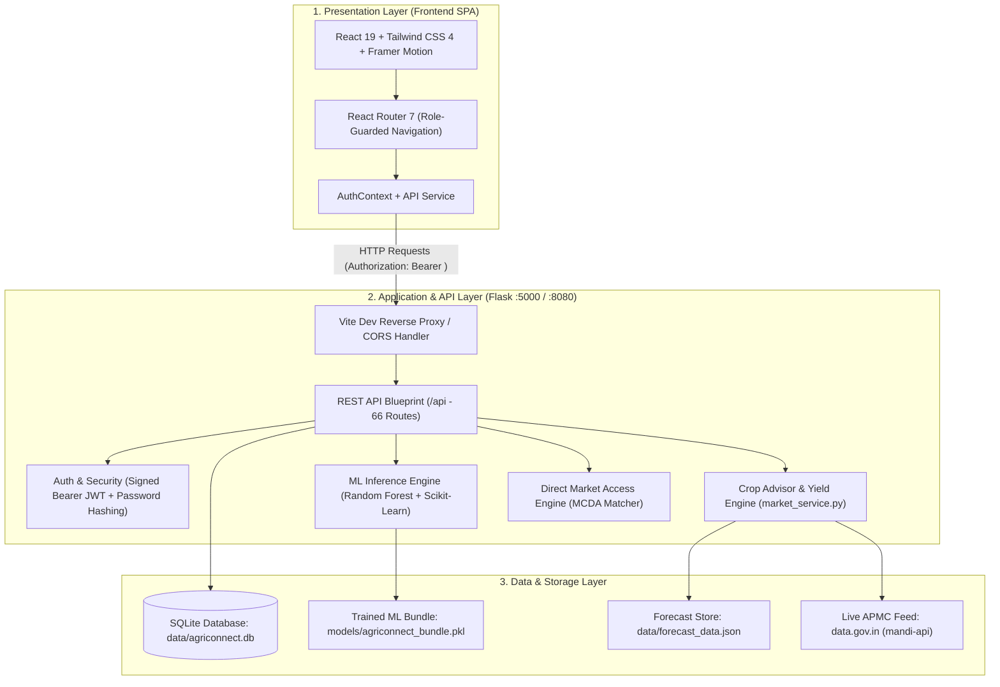

# AgriConnect — AI-Based Crop Price Prediction and Direct Market Access

[](https://www.python.org/)
[](https://flask.palletsprojects.com/)
[](https://react.dev/)
[](https://vitejs.dev/)
[](https://tailwindcss.com/)
[](https://scikit-learn.org/)
[](LICENSE)

**AgriConnect** is a full-stack agricultural marketplace and intelligence platform designed for Indian agriculture (focusing on Karnataka APMC mandis). It connects **farmers, wholesale buyers, and market administrators** in one unified ecosystem while integrating an advanced AI/ML decision-making layer:
- **Point-in-Time Mandi Price Prediction** (Random Forest Regressor)
- **52-Week Forward Price Forecasting** (Facebook Prophet & Holt-Winters Exponential Smoothing)
- **Error-Discounted Crop Recommendation Engine** ("What should I grow next?")
- **Localized Crop Yield Prediction** (Multi-factorial baseline model)
- **Disintermediated Direct Marketplace** (Algorithmic Multi-Criteria Matcher & Negotiation Engine)

---

## 📌 Table of Contents
- [Highlights & Real-World Impact](#-highlights--real-world-impact)
- [System Architecture](#-system-architecture)
- [Machine Learning & Algorithmic Models](#-machine-learning--algorithmic-models)
- [Direct Market Access & Disintermediation](#-direct-market-access--disintermediation)
- [Tech Stack](#-tech-stack)
- [Project Layout](#-project-layout)
- [Installation & Setup](#-installation--setup)
- [Running the Application](#-running-the-application)
- [Demo Credentials](#-demo-credentials)
- [API Reference](#-api-reference)
- [Security & Architecture Guards](#-security--architecture-guards)
- [License & Acknowledgments](#-license--acknowledgments)

---

## 🌟 Highlights & Real-World Impact

1. **42 Crops across 21 Karnataka Districts**: Comprehensive tracking covering cereals, oilseeds, pulses, fibre, vegetables, fruits, and spices.
2. **Three-Tier Hybrid Mandi Price Feed**:
   - **Tier 1 (Local Cache)**: 6-hour TTL in SQLite (`price_snapshots`) for instant sub-millisecond retrieval.
   - **Tier 2 (Live APMC API)**: Real-time modal, min, and max rates sourced from Ministry of Agriculture / data.gov.in.
   - **Tier 3 (Model Fallback)**: Deterministic regional seasonality model guaranteeing zero server crashes during network outages.
3. **Explaining AI Decisions**: The recommendation engine discounts projected 90-day price growth by historical model validation error (Mean Absolute Error %), ensuring reliable sowing advice.
4. **End-to-End Direct Trade**: Enables wholesale buyers to post requirements, matches them with local farmer listings via a weighted 6-criteria algorithm, facilitates bilateral counter-offers, and locks orders in a forward-only state machine.

---

## 🏗️ System Architecture



---

## 🧠 Machine Learning & Algorithmic Models

### 1. Point-in-Time Price Regressor
- **Algorithm**: `RandomForestRegressor(n_estimators=100, random_state=42)`
- **Bundle File**: `models/agriconnect_bundle.pkl` (~96 MB)
- **Features Used (10)**:
  `['Commodity', 'Commodity_Code', 'District', 'Grade', 'Market', 'Variety', 'Day', 'Month', 'Year', 'Season']`
- **Encoding**: Scikit-Learn `LabelEncoder` for nominal categories + Ordinal Encoding for produce quality `Grade` (`Non-FAQ`: 0 $\rightarrow$ `FAQ`: 6).
- **Feature Importance**: Commodity (38.35%), Variety (19.67%), Year (17.85%), Commodity Code (11.68%), Day (4.70%), Month (3.25%), Market (2.05%), Season (1.09%), District (0.74%), Grade (0.61%).

### 2. Time-Series Price Forecasting
- Evaluated both **Facebook Prophet** and **Holt-Winters Exponential Smoothing** on weekly resampled APMC price histories.
- Champion model selected per commodity based on lowest validation **Mean Absolute Error (MAE %)**:
  - **Cotton**: Prophet (MAE: ₹581.65, Error: 10.85%, Confidence: 89.1%)
  - **Groundnut**: Prophet (MAE: ₹1927.39, Error: 42.05%, Confidence: 57.9%)
  - **Maize**: Holt-Winters (MAE: ₹334.29, Error: 21.13%, Confidence: 78.9%)
  - **Ragi**: Prophet (MAE: ₹255.02, Error: 10.87%, Confidence: 89.1%)
  - **Rice**: Holt-Winters (MAE: ₹970.07, Error: 23.90%, Confidence: 76.1%)
  - **Wheat**: Holt-Winters (MAE: ₹285.10, Error: 9.39%, Confidence: 90.6%)

### 3. "What Should I Grow Next?" Crop Recommendation Formula
$$\text{Projected Growth \%} = \frac{\bar{y}_{\text{next 90 days}} - y_{\text{last actual}}}{y_{\text{last actual}}} \times 100$$
$$\text{Confidence} = \max\left(0, 1.0 - \frac{\min(\text{MAE \%}, 100)}{100}\right)$$
$$\text{Recommendation Score} = \text{Projected Growth \%} \times \text{Confidence}$$

### 4. Multi-Factorial Yield Prediction
$$\text{Expected Yield (q/acre)} = \text{District Baseline} \times \text{Soil Factor} \times \text{Water Factor} \times \text{Seasonality} \times \text{Area Scaling}$$
- Automatically estimates maturity days and harvest date based on sowing timestamp.
- Incorporates coefficient of variation ($\text{CV}$) to output 10th and 90th percentile confidence bounds.

---

## 🤝 Direct Market Access & Disintermediation

### 1. Multi-Criteria Decision Analysis (MCDA) Matcher
When a buyer submits a produce demand requirement, candidate farmer listings are ranked across 6 weighted dimensions:
- **Crop Compatibility** (28%): Exact commodity verification.
- **Price Compatibility** (22%): Evaluates quote against buyer's target price window $[P_{\min}, P_{\max}]$.
- **Quantity Compatibility** (18%): Matches required lot size.
- **Quality Compatibility** (18%): Grade compatibility score.
- **Location & Haulage Distance** (9%): Transit distance calculated via the Haversine formula.
- **Availability Status** (5%): Readily available inventory verification.

### 2. Negotiation & Offer Counter-Bidding
- Buyer sends offer $\rightarrow$ Farmer can accept, decline, or counter-bid $\rightarrow$ Buyer can counter back or accept.
- Upon acceptance, an official order is automatically booked in the `orders` table.

### 3. Forward-Only Order State Machine
$$\text{accepted} \longrightarrow \text{preparing} \longrightarrow \text{dispatched} \longrightarrow \text{delivered} \longrightarrow \text{completed}$$
- **Role Segregation**: Farmer (seller) advances through `preparing` $\rightarrow$ `dispatched` $\rightarrow$ `delivered`.
- **Completion Lock**: Only the **Buyer** can confirm delivery and mark `completed` (farmers get HTTP 403 if they attempt to complete).
- **Mutual Ratings**: Bilateral 1–5 star reviews upon order completion, dynamically recomputing user reputation ratings.

---

## 💻 Tech Stack

- **Backend**: Python 3.11, Flask 3.1, SQLite 3, Werkzeug, ItsDangerous.
- **Machine Learning**: Scikit-Learn, Pandas, NumPy, Facebook Prophet, Statsmodels (Holt-Winters).
- **Frontend**: React 19, Vite 8, React Router 7, Tailwind CSS 4, Framer Motion, Recharts, Lucide React.
- **Data Source**: Ministry of Agriculture & Farmers Welfare, data.gov.in / Agmarknet APMC feed.

---

## 📁 Project Layout

```
agriconnect_app/
├── app.py                      # Flask entrypoint: template routes + API blueprint registration
├── run.py                      # Development server runner (:8080 or :5000)
├── api.py                      # 66 REST API routes, auth, SQLite access, business logic
├── market_service.py           # Mandi feed, 3-tier cache, yield predictor, MCDA logic
├── extract_forecast_data.py    # Time-series data extraction pipeline
├── requirements.txt            # Python dependencies
├── QA_REPORT.md                # 184-test autonomous QA validation report
├── data/
│   ├── agriconnect.db          # SQLite relational database (11 tables)
│   └── forecast_data.json      # 52-week time-series forecasts & error metrics
├── models/
│   └── agriconnect_bundle.pkl  # Trained Random Forest model + encoders (~96 MB)
├── templates/ & static/        # Classic Flask template portal (/predict, /recommend, /help)
└── frontend/                   # Modern React 19 SPA
    ├── package.json
    ├── vite.config.js          # Vite reverse-proxy configuration
    └── src/
        ├── components/         # Modular UI kit, charts, status badges
        ├── context/            # AuthContext (JWT session management)
        ├── pages/
        │   ├── app/            # Farmer workspace (Dashboard, Market, Advisor, Planner)
        │   ├── buyer/          # Buyer workspace (Requirements, Matcher, Offers, Orders)
        │   ├── admin/          # Admin console (Users, Listings, AI Models, Reports)
        │   └── auth/           # Login & Registration views
        └── services/           # Typed API communication layer
```

---

## ⚙️ Installation & Setup

### Prerequisites
- **Python**: 3.9+ (tested on Python 3.11)
- **Node.js**: 20+ (tested on Node v24) and **npm**
- **Git** (with Git LFS for model bundle support)

### 1. Clone the Repository
```bash
git clone https://github.com/sanskrutigugawad782-art/AI-Based-Crop-Price-Prediction-and-Direct-Market-Access.git
cd AI-Based-Crop-Price-Prediction-and-Direct-Market-Access
```

### 2. Backend Setup
```bash
# Create and activate virtual environment
# Windows (PowerShell):
python -m venv .venv
.\.venv\Scripts\Activate.ps1

# Linux / macOS:
python3 -m venv .venv
source .venv/bin/activate

# Install required Python dependencies
pip install -r requirements.txt
```

### 3. Frontend Setup
```bash
cd frontend
npm install
cd ..
```

---

## 🚀 Running the Application

### Terminal 1 — Backend REST API
```bash
# Windows:
.\.venv\Scripts\python app.py

# Linux / macOS:
python app.py
```
*Backend API and Classic ML Portal will start at `http://127.0.0.1:5000`.*

### Terminal 2 — React Frontend Dev Server
```bash
cd frontend
npm run dev
```
*Modern React Web App will launch at `http://127.0.0.1:5173`.*

---

## 🔑 Demo Credentials

Pre-seeded accounts ready for evaluation and presentation:

| Role | Email | Password | Access & Features |
|---|---|---|---|
| **Farmer** | `farmer@agriconnect.in` | `demo1234` | Farm profile, produce listings, AI crop advisor, yield calculator, cost planner, offer negotiation |
| **Buyer** | `buyer@agriconnect.in` | `demo1234` | Demand requirements, MCDA supplier matcher, offer bidding, order receipt confirmation |
| **Admin** | `admin@agriconnect.in` | `demo1234` | User suspension/verification, marketplace moderation, AI model inventory monitor |

---

## 📡 API Reference

All protected endpoints require an `Authorization: Bearer <token>` header:

| Domain | Method & Endpoint | Description |
|---|---|---|
| **System** | `GET /api/health` | Service health status |
| **Auth** | `POST /api/auth/login` | Authenticate and obtain signed 7-day token |
| | `POST /api/auth/register` | Register new farmer or buyer |
| | `GET /api/auth/me` | Fetch authenticated user profile |
| **Market** | `GET /api/market/snapshot` | 42-crop state-wide price snapshot |
| | `GET /api/market/prices` | Query mandi price for specific crop & district |
| | `GET /api/market/history` | Historical price trends (up to 365 days) |
| | `GET /api/market/district-comparison` | Net profit opportunity comparison across districts |
| **AI Advisor**| `GET /api/advisor/recommendation` | Top recommended crops ranked by error-adjusted growth |
| | `POST /api/yield/predict` | Localized crop yield prediction (q/acre) |
| | `GET /api/planner/estimate` | Per-acre input cost and breakeven economics |
| **Matcher** | `GET /api/buyer/matches` | Rank candidate farmer listings for a requirement |
| | `GET /api/buyer/match-analysis` | Explainable compatibility breakdown across 6 factors |
| **Offers** | `POST /api/buyer/offers` | Send negotiation offer |
| | `POST /api/farm/offers/<id>/counter` | Counter-bid offer with revised price or quantity |
| | `POST /api/farm/offers/<id>/accept` | Accept offer terms and automatically generate order |
| **Orders** | `GET /api/orders` | List user orders with status and counterpart details |
| | `POST /api/orders/<id>/status` | Advance status (`preparing` $\rightarrow$ `dispatched` $\rightarrow$ `delivered` $\rightarrow$ `completed`) |
| | `POST /api/orders/<id>/rate` | Submit 1–5 star peer rating |

---

## 🛡️ Security & Architecture Guards

- **Token Expiry**: Cryptographically signed URL-safe tokens with a 7-day sliding window.
- **Account Quarantine**: Suspended users are immediately blocked at login and on any active session token.
- **IDOR Protection**: Strict ownership verification prevents users from viewing or modifying orders/offers that do not belong to them.
- **Admin Protection**: Built-in safeguards prevent administrators from accidentally or maliciously suspending their own accounts.
- **Network Resilience**: 3-tier hybrid data architecture ensures that third-party API downtime degrades to deterministic models without crashing.

---

## 📄 License & Acknowledgments

- **License**: Released under the MIT License.
- **Data Attribution**: Sourced from the Ministry of Agriculture & Farmers Welfare, Directorate of Marketing & Inspection (AGMARKNET), and the Open Government Data Platform (data.gov.in).
- **Academic Context**: Developed as a Final-Year Engineering Project demonstrating applied Artificial Intelligence and Full-Stack Engineering in Indian Agriculture.
